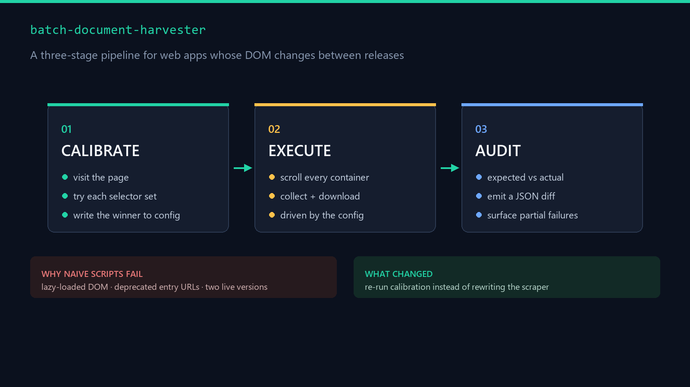

# Batch Document Harvester

A Playwright-based framework for harvesting documents and reading structured state from
dynamic web apps whose DOM changes between versions — with a calibration pass, a
scroll-and-collect loop, and an audit report instead of blind automation.


---

## The problem

The target application had four properties that break naive scripting:

| Property | Why naive automation fails |
|---|---|
| Content loads on scroll, not on page load | `page.content()` returns an empty shell |
| Multiple entry-point URLs, some deprecated | A hardcoded URL breaks silently |
| Two DOM versions in production simultaneously | One selector set matches half the pages |
| Session expires quickly | Every run starts logged out |

Most scraping attempts against this kind of target fail at step one, and the person gives up.

---

## Architecture



```
┌─────────────────┐
│  launch         │  detect installed Edge / Chrome, reuse the system browser
└────────┬────────┘
         ↓
┌─────────────────┐
│  probe          │  try N candidate entry URLs, keep the first that resolves
└────────┬────────┘
         ↓
┌─────────────────┐
│  calibrate      │  walk the DOM, record which selector set matches → config
└────────┬────────┘
         ↓
┌─────────────────┐
│  execute        │  scroll-and-collect or download — driven by the calibration
└────────┬────────┘
         ↓
┌─────────────────┐
│  audit          │  compare expected vs actual, emit a machine-readable diff
└─────────────────┘
```

---

## Four engineering decisions

### 1. Reuse the system browser instead of downloading Chromium

Playwright ships bundled browsers, but on a locked-down machine that download fails or
takes minutes. The launcher probes `ProgramFiles` for an installed Edge or Chrome and
passes `channel: 'msedge'` / `channel: 'chrome'` instead.

```js
const cands = {
  msedge: [`${process.env['ProgramFiles(x86)']}\\Microsoft\\Edge\\Application\\msedge.exe`, ...],
  chrome: [`${process.env.ProgramFiles}\\Google\\Chrome\\Application\\chrome.exe`, ...],
};
for (const [channel, paths] of Object.entries(cands))
  if (paths.some((p) => p && fs.existsSync(p))) return { ...base, channel };
```

**Result:** cold start drops from ~40s to ~3s, and no 200MB download.

### 2. Calibrate before acting

Rather than hardcoding selectors, a calibration pass visits the page, tries each known
selector set, and writes the winner to a config file. Execution reads that config.

**Why it matters:** when the app changes, you re-run calibration instead of rewriting code.

### 3. Scroll until the DOM stops growing

Lazy-loaded content means a single `evaluate` sees only the first screen. The collector
walks every scrollable container, not just `document.scrollingElement` — because this app
scrolls inside a nested div.

```js
for (const el of [document.scrollingElement, ...document.querySelectorAll('div,ul,section')]) {
  if (!el || el.scrollHeight - el.clientHeight < 30) continue;
  el.scrollTop += Math.max(500, el.clientHeight * step);
}
```

### 4. Audit, don't trust

Every run produces an audit file comparing what was expected against what actually landed
in the DOM. Silent partial failures are the main failure mode in automation — the audit
makes them visible instead of letting you ship broken output.

---

## Iteration history

This was not written in one pass. The extraction layer went through seven versions and the
submission layer through four, each one because the previous version failed on a real page.

**That iteration record is the actual skill** — not the final file.

---

## Quick start

```bash
npm install
npx playwright install --with-deps   # optional: skipped when a system browser is found

# 1. discover which selector set matches the current build
node src/calibrate.js https://example.com/app

# 2. collect
node src/collect.js https://example.com/app

# 3. verify what you got
node src/audit.js
```

A persistent `.profile/` directory keeps the login session between runs, so you log in once.

---

## Configuration

`calibrate.js` writes `calibrate.json`. A template lives in
[`config/selectors.example.json`](config/selectors.example.json) — copy it and adjust the
selectors to your own target.

```json
{
  "activeSet": "v2",
  "sets": {
    "v2": { "container": ".contentCard", "item": ".item", "title": ".mark_name" },
    "v1": { "container": ".legacyCard", "item": ".itemLegacy", "title": ".title_v1" }
  }
}
```

---

## Stack

`Node.js` · `Playwright` · system-browser channel · JSON-driven selectors

---

## Scope

This is a generic harvesting and verification framework. It is meant for data you are
authorised to access — your own accounts, your own site, or a target whose terms permit
automated access. Selectors and URLs in this repository are placeholders.

If you need this adapted to your own site, the pattern above (calibrate → execute → audit,
with selector sets kept in config) is what makes it survive a redesign.

---

## License

MIT
